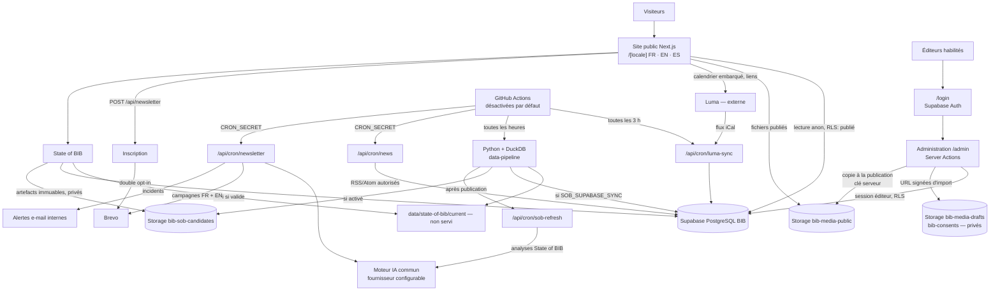
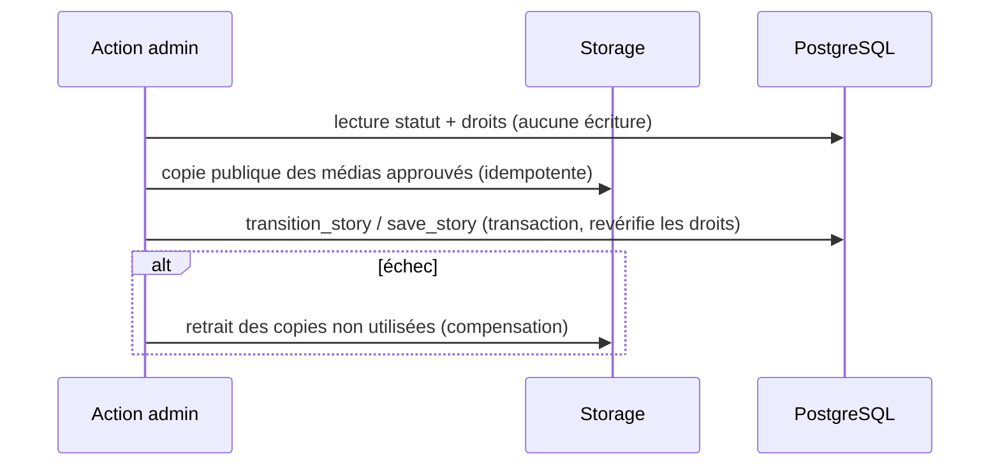

# Architecture — Black in Blockchain

Architecture **réellement implémentée** dans ce dépôt. Les services externes
(Supabase BIB, Brevo, fournisseur IA, planification) sont intégrés dans le
code mais **désactivés par défaut** : voir [DEPLOYMENT.md](DEPLOYMENT.md).

## Vue d'ensemble



## Composants

| Composant | Emplacement | Rôle |
| --- | --- | --- |
| Site public | `src/app/[locale]/(public)/` | Pages traduites ; lecture des seuls contenus publiés (client anonyme, cache par étiquettes) |
| Espace opérateurs | `src/app/(operateurs)/` | `/login`, `/register` (fermé), `/dashboard` → `/admin`, administration |
| Proxy | `src/proxy.ts` | Routage de langue next-intl ; rafraîchissement de session Supabase et première barrière pour `/admin` |
| Accès Supabase | `src/lib/supabase/` | `server.ts` (session, RLS), `public.ts` (anonyme, cache), `admin.ts` (clé secrète, serveur seulement), `client.ts` (navigateur, imports signés) |
| Autorisation | `src/lib/auth/editor.ts` | `requireEditor()` / `requireAdmin()` : jeton vérifié + habilitation `public.editors` |
| Événements | `src/lib/events/`, `src/components/events/` | Requêtes publiques, calendrier liste/mois, compléments éditoriaux, calcul à venir / en cours / passé, fuseaux |
| BIB en action | `src/lib/stories/`, `src/lib/media/`, `src/components/en-action/` | Rétrospectives, médias, publication/retrait des copies publiques, aperçus signés |
| Luma | `src/lib/luma.ts`, `src/lib/events/ical.ts`, `luma-sync.ts` | Calendrier embarqué, validation des URL, synchronisation du flux iCal vers Supabase |
| State of BIB | `src/lib/sob/`, `data-pipeline/` | Lecture du snapshot courant (Supabase ou JSON), historique, insights |
| Newsletter | `src/lib/newsletter/`, `src/lib/brevo.ts`, `src/app/api/newsletter/` | Inscription, cycle autonome, rendu, contrôles, envoi idempotent |
| Veille | `src/lib/news/ingest.ts` | Flux RSS/Atom autorisés, thèmes, déduplication |
| Moteur IA | `src/lib/ai/engine.ts` | Adaptateurs « anthropic » / « openai-compatible », budget, sortie JSON validée, traces `ai_runs` |
| Opérations éditoriales | `src/lib/editorial/rpc.ts` + RPC `save_*`, `replace_story_media`, `transition_*` | Écritures transactionnelles, verrou optimiste, erreurs traduites |
| Médias (contrôles) | `src/lib/media/sniff.ts`, `inspect.ts`, `reconcile.ts` | Signature binaire réelle, rapport de réconciliation en lecture seule |
| Contenus non sourcés | `src/lib/content/claims.ts` | Registre central de visibilité (masqués par défaut) |
| Sécurité | `src/lib/security/headers.ts`, `rate-limit.ts`, `cron.ts`, `src/lib/dom/safe.ts`, `src/lib/net/` | CSP/en-têtes, limiteur partagé (échec fermé), CSRF, rendu DOM sûr, garde-fous SSRF |
| Exploitation | `src/lib/ops/incidents.ts`, `src/lib/ops/log.ts` | Incidents + alertes e-mail ; journaux JSON corrélés et masqués |
| Base | `supabase/migrations/` (0001 → 0013), `supabase/ops/`, `supabase/tests/` | Schéma, RLS, fonctions, buckets ; préflight et inventaire ; tests SQL |
| Automatisations | `.github/workflows/` | `ci.yml`, `refresh-data.yml` (vérification, ingestion, réconciliation, analyses), `events-sync.yml`, `news-ingest.yml`, `newsletter.yml` |

## Principaux flux

**Publication d'une rétrospective.** L'éditeur importe un fichier : le serveur
contrôle type et taille, émet une URL signée vers le bucket privé, puis
revérifie l'objet stocké. À la publication, chaque média associé doit avoir des
droits approuvés, une référence d'autorisation et (photo) un texte alternatif ;
il est alors copié vers le bucket public. Le cache public est invalidé par
étiquette (`stories`, `media`).

**Retrait.** Retirer, archiver ou révoquer les droits supprime les copies
publiques qui ne sont plus utilisées par un contenu publié et invalide le cache.

**Cycle newsletter (America/Toronto).**

```mermaid
sequenceDiagram
    participant GH as GitHub Actions
    participant API as /api/cron/newsletter
    participant IA as Moteur IA
    participant BR as Brevo
    GH->>API: lundi — generate
    API->>IA: brouillon FR+EN (données publiées uniquement)
    API->>API: rendu + contrôles hors IA → drafted / blocked
    GH->>API: mardi — check
    API->>API: recontrôle ; régénération bornée si échec
    API->>API: FR ET EN valides → eligible, sinon blocked + alerte
    GH->>API: mercredi 09:02 (EDT et EST)
    API->>API: fenêtre 09:00–09:59 Toronto ? verrou « sending »
    alt éligible
        API->>BR: campagne FR puis EN (clé d'idempotence, réconciliation)
    else non éligible ou créneau dépassé
        API->>API: annulation de la semaine, alerte e-mail, aucun rattrapage
    end
```

**État des publications éditoriales.** Les écritures dépendantes passent par
des fonctions PostgreSQL (`SECURITY INVOKER`, donc soumises à la RLS) : fiche,
traductions et journal d'audit dans une même transaction ; verrou optimiste
(`updated_at` lu à l'ouverture) ; transitions conditionnelles et idempotentes.
Storage et PostgreSQL ne partageant pas de transaction, l'ordre est :
validation → copie publique des médias → transaction en base ; en cas d'échec
de la transaction, compensation (retrait des copies devenues inutiles) ; tout
résidu est visible dans le rapport de réconciliation.



**State of BIB.** Chaque heure, `check_version.py` lit le manifeste de la source
(sans téléchargement lourd) et calcule l'empreinte des ressources utilisées :
une nouvelle version **ou une correction sous le même numéro** déclenche le
traitement (reprises automatiques bornées). `build_data.py` lit
les ressources **annoncées par le manifeste**, contrôle leur intégrité, calcule
les indicateurs Afrique/Caraïbes et valide le lot. `publish_supabase.py ingest`
enregistre le rapport de validation, bloque un lot invalide, historise la
candidate (bucket privé, SHA-256, observations) puis applique le mode
(`auto`, réglage actuel : publication sans approbation, contrôles renforcés en
cas de forte variation, quarantaine sinon ; `review` / `paused` restent
disponibles). La bascule de la version courante est atomique
dans PostgreSQL ; `reconcile` contrôle ensuite PostgreSQL, Storage et la copie
technique du dépôt et signale tout écart. Le site lit la version courante côté
serveur, vérifie les empreintes, et affiche un **état d'indisponibilité** s'il
n'existe ni version valide ni copie de repli valide. Aucun export public
n'existe ; les fournisseurs et licences ne sont présentés que sur la page
légale `/data-sources`. Détails : `V2_ARCHITECTURE_CIBLE.md`.

## Séparation des responsabilités

- **Le code calcule, l'IA rédige.** Aucun chiffre n'est produit par le modèle :
  il utilise des marqueurs `{{fact:clé}}` remplacés par le code, et tout chiffre
  libre fait échouer les contrôles.
- **Brevo est la source de vérité des contacts.** BIB ne stocke qu'une empreinte
  de l'adresse et la version du texte de consentement.
- **Luma est la source de vérité des événements.** BIB lit le flux iCal public
  du calendrier et n'écrit rien dans Luma ; aucune donnée de participant, de
  billet ou de paiement n'est importée.
- **Supabase BIB est dédié.** Aucun projet d'un autre produit n'est utilisé.

## Observatoire State of BIB (V2)

```
page serveur (cache 15 min, invalidé après publication) ── JSON de la version courante (Supabase, lecture serveur)
   └─ SobExplorerProvider (client) ── état des filtres ⇄ URL (history.replaceState)
        ├─ SobFilterBar      région · métrique · période · réinitialiser · lien
        ├─ SobMap            D3 + TopoJSON : SVG construit une fois, zoom d3-zoom,
        │                    mises à jour d'attributs seulement, panneau de détails
        ├─ SobEcosystems     courbes (curseur, lecture, brush) + classement FLIP
        └─ SobCohort         aires empilées, catégories, effectifs/parts
```

- Calculs purs et testés dans `src/lib/sob/explore.ts` (filtres, URL, rangs,
  parts, périodes, classements, cohortes, réduction de séries longues). Aucune
  valeur n'est interpolée ; une valeur absente reste un trou.
- Graphiques lourds montés à l'approche de l'écran (`LazyMount`), animations
  annulées au démontage, écouteurs D3 retirés, `prefers-reduced-motion`.
- Pas de série mensuelle par pays dans la source : aucune animation
  géographique historique (voir `docs/SOB_EVOLUTIONS.md`).
- Fraîcheur : `src/lib/sob/freshness.ts` (date réelle de l'instantané, seuil
  120 jours).


## V2 — architecture cible

La V2 (Luma source de vérité des événements, State of BIB publié automatiquement depuis Supabase, modes auto/review/paused, édition humaine de la newsletter, migrations 0011 à 0013) est décrite dans [`V2_ARCHITECTURE_CIBLE.md`](V2_ARCHITECTURE_CIBLE.md) et [`SOB_AUTOMATION.md`](SOB_AUTOMATION.md). En cas de divergence avec une section plus ancienne de ce document, ces deux guides font foi.
