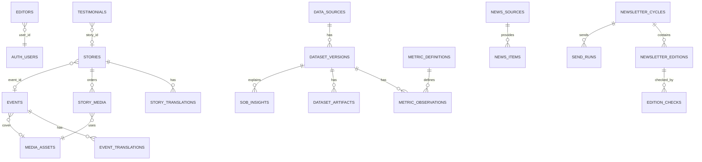

# Modèle de données — Supabase BIB

Les migrations sont dans `supabase/migrations/` et **n'ont été appliquées sur
aucune base distante**. Elles ont été vérifiées par analyse syntaxique
(`pglast`) et par exécution sur une base PostgreSQL 16 **locale et jetable**
munie de substituts minimaux des schémas Supabase `auth` et `storage`.

| Migration | Domaine |
| --- | --- |
| `20261112000100_core_admin.sql` | Habilitations, audit, limitation de débit |
| `20261112000200_events.sql` | Événements |
| `20261112000300_bib_en_action.sql` | Rétrospectives, médias, témoignages, buckets |
| `20261112000400_state_of_bib.sql` | Historisation State of BIB, bucket snapshots |
| `20261112000500_newsletter_ai.sql` | Veille, IA, newsletter, incidents, consentements, insights |

## Relations principales

## Tables

### Administration

| Table | Colonnes clés | Notes |
| --- | --- | --- |
| `editors` | `user_id` → `auth.users`, `role` (`editor`/`admin`), `active` | Aucune écriture via l'API ; création par SQL ou clé secrète |
| `editorial_audit` | `actor_id`, `action` (`objet.verbe`), `entity_type`, `entity_id`, `details` | Insertion par l'éditeur lui-même ; pas de modification ni suppression |
| `rate_limit_hits` | `bucket_key`, `window_start`, `hits` | Fonction `consume_rate_limit()` réservée à `service_role` |

Fonctions : `private.is_editor()`, `private.is_admin()` (security definer, schéma
non exposé) utilisées par les politiques ; `public.current_editor_role()` (RPC
pour l'utilisateur connecté).

### Événements

| Table | Colonnes clés |
| --- | --- |
| `events` | `slug` unique, `status` (`draft`/`published`/`archived`), `starts_at`, `ends_at`, `time_zone` (IANA), `mode`, lieu, `online_url`, `luma_url` (contrainte `https://lu.ma/…` ou `https://luma.com/…`), `cover_media_id` |
| `event_translations` | (`event_id`, `locale` fr/en/es) PK, `title`, `summary`, `description` |

La catégorie temporelle n'est **pas stockée** : elle est calculée depuis les
dates. Index : `(status, starts_at)`, `(starts_at desc)`.

### BIB en action

| Table | Colonnes clés |
| --- | --- |
| `media_assets` | `kind` (image/video/poster/subtitles), `draft_path` (bucket privé), `public_path` (bucket public, si publié), `mime_type`, `size_bytes` (≤ 200 Mo), dimensions/durée, `alt_text` jsonb {fr,en,es}, `credit`, `rights_holder`, `rights_reference`, `rights_status` (pending/approved/rejected/revoked), `consent_proof_path`, `poster_media_id`, `subtitles_media_id` |
| `stories` | `slug`, `status`, `event_id`, `occurred_on`, `cover_media_id`, `featured_video_id` |
| `story_translations` | `title`, `summary`, `body`, `seo_description` par langue |
| `story_media` | (`story_id`, `media_id`) PK, `position`, `caption` jsonb |
| `testimonials` | `quote` (langue d'origine), `author_name`, `author_role`, `consent_reference` (obligatoire), `consent_proof_path`, `status` |

Contrainte : `public_path` ne peut exister que si les droits sont approuvés et
référencés.

Vues publiques : `media_public` (colonnes non sensibles des médias diffusés) et
`testimonials_public` (sans preuve de consentement). Ces vues s'exécutent avec
les droits de leur propriétaire et filtrent elles-mêmes le publiable.

### State of BIB

| Table | Colonnes clés |
| --- | --- |
| `data_sources` | `id` (`electric-capital-osdd`), licence, attribution, note de périmètre |
| `dataset_versions` | `provider_version` (unique par source), `as_of_date`, `status` (detected → processing → validated → published → superseded / failed), `pipeline_version`, `is_current` (un seul par source) |
| `ingestion_runs` | `kind` (version_check/build/publish), `trigger`, `status`, horodatages, message |
| `metric_definitions` | `key`, libellés FR/EN/ES, unité, méthode |
| `metric_observations` | `dataset_version_id`, `metric_key`, `dimension_type` (total/country/city/…), `dimension_value`, `period_start/end`, `as_of_date`, `value` — unique par version × indicateur × dimension × période |
| `dataset_artifacts` | `name`, `storage_path` (unique), `sha256`, `size_bytes` |

Distinction des dates : `as_of_date` (référence de la donnée), `period_*`
(période statistique), `detected_at` / `processed_at` (ingestion),
`provider_version`, `pipeline_version`, `published_at` (publication). Un même
chiffre n'est jamais réenregistré chaque jour : une observation n'existe que
pour une nouvelle version source.

Fonction `publish_dataset_version(uuid)` (service_role) : idempotente,
transactionnelle, refuse une version non validée ou sans artefact.

### Newsletter, veille, IA

| Table | Rôle |
| --- | --- |
| `news_sources` | Sources RSS/Atom ; `enabled` exige `authorized_by` + `authorized_at` ; `usage_terms` obligatoire |
| `news_items` | `canonical_url` et `fingerprint` uniques, `theme` (6 thèmes), `region_tags` |
| `ai_runs` | Fournisseur, modèle, statut, jetons (sans contenu) |
| `newsletter_cycles` | `week_start` unique (lundi Toronto), `send_slot`, `status`, `regen_attempts` |
| `newsletter_editions` | (`cycle_id`, `locale` fr/en, `version`) unique, contenu structuré, HTML, sources |
| `edition_checks` | Résultat de chaque contrôle (bloquant, réussi, détails) |
| `send_runs` | `idempotency_key` unique (`semaine:langue`), `brevo_campaign_id`, statut |
| `ops_incidents` | Type, gravité, message, `notified_at` |
| `newsletter_consents` | `email_sha256` (avec poivre), langue, version du texte de consentement, `status` de la **demande** (`pending` → `requested` / `request_failed`, migration 0008) ; la confirmation reste dans Brevo |
| `sob_insights` | Brouillons IA ; lecture publique seulement si `status = published` |

## Sécurité (RLS)

- RLS activée sur **toutes** les tables du schéma `public`.
- `anon` : lecture seule des contenus publiés (`events`, `stories`, traductions,
  `story_media`, vues `media_public` / `testimonials_public`, versions publiées
  de State of BIB, insights publiés). Aucune écriture.
- `authenticated` + `private.is_editor()` : lecture/écriture des contenus
  éditoriaux ; lecture des tables d'exploitation. Une session authentifiée sans
  habilitation n'a aucun droit supplémentaire.
- `service_role` (clé secrète, serveur) : pipeline, cycle newsletter,
  publication des médias. Aucun droit n'est fondé sur `user_metadata`.

## Storage

| Bucket | Public | Limite | Types | Accès |
| --- | --- | --- | --- | --- |
| `bib-media-drafts` | Non | 200 Mo | JPEG, PNG, WebP, AVIF, MP4, VTT | Éditeurs (politiques `storage.objects`) |
| `bib-consents` | Non | 10 Mo | PDF, JPEG, PNG | Éditeurs |
| `bib-media-public` | Oui (lecture) | 200 Mo | idem drafts | Écriture serveur uniquement |
| `bib-sob-snapshots` | Oui (lecture) | 50 Mo | JSON | Écriture pipeline uniquement, **après promotion** |
| `bib-sob-candidates` | Non | 50 Mo | JSON | Pipeline uniquement (candidates en attente de revue, 0007) |

Chemins : `uploads/AAAA/MM/<uuid>.<ext>` (brouillons), `published/<media_id>/…`
(public), `media/<media_id>/<uuid>.<ext>` (preuves),
`versions/<provider_version>/<fichier>.json` (snapshots et candidates).
Les chemins des brouillons et preuves sont imposés par les politiques Storage
(migration 0006).
Limites applicatives plus strictes à l'import : photos 15 Mo, vidéo 200 Mo,
sous-titres 1 Mo.

## Migrations correctives (0006 → 0008)

Aucune table ajoutée : le modèle compte toujours **26 tables**.

| Migration | Ajouts |
|---|---|
| `20261113000600_editorial_integrity` | `save_event`, `save_story`, `replace_story_media`, `transition_event`, `transition_story` (INVOKER, transaction unique, audit, verrou optimiste) ; `private.media_is_publishable`, `private.assert_editor` ; déclencheur interdisant la suppression d'un média publié ; `media_storage_report` (service, lecture seule) ; politiques Storage avec `WITH CHECK` et chemins |
| `20261113000700_sob_governance` | `dataset_versions.approved_commit_sha`, `candidate_at` ; bucket privé `bib-sob-candidates` ; `promote_dataset_version` (empreintes vérifiées), `rollback_dataset_version` ; `publish_dataset_version` révoquée pour le service ; une seule préparation en cours |
| `20261113000800_newsletter_integrity` | `newsletter_validate_pair` (atomique) ; éditions validées/envoyées immuables ; envois confirmés définitifs ; états de demande de consentement |

Codes d'erreur applicatifs : `BIB01` conflit de modification, `BIB02`
introuvable, `BIB03` média non diffusable, `BIB04` transition interdite,
`BIB05` contenu incomplet, `BIB06` empreintes State of BIB différentes.
